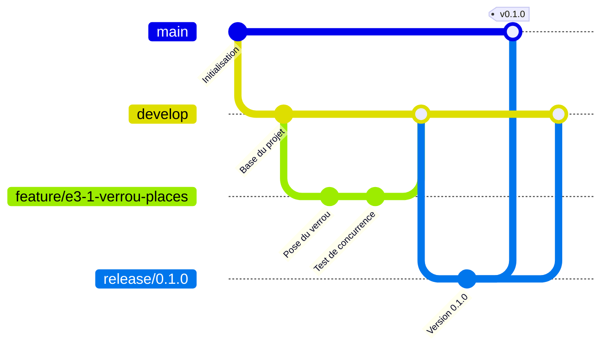

# Contribuer au projet

Ce document fixe les règles de travail avec Git : branches, commits et fusions. Il s'applique à toute modification du dépôt, y compris celles faites seul.

## 1. Branches permanentes

| Branche | Rôle | Règles |
|---|---|---|
| `main` | Code livré, stable. Chaque version publiée y est repérée par une étiquette (tag). | Aucun commit direct. Reçoit uniquement des branches `release/*` et `hotfix/*`. |
| `develop` | Intégration du travail en cours. Point de départ de toutes les branches de travail. | Aucun commit direct. Reçoit les branches `feature/*`, `fix/*`, `docs/*`, `chore/*`, `refactor/*` et `test/*`. Doit toujours pouvoir être déployée en préproduction. |

## 2. Convention de nommage des branches temporaires

### Format

```text
<type>/<code-backlog>-<description-courte>
```

- `<type>` : un des types du tableau ci-dessous.
- `<code-backlog>` : le code de l'EPIC ou de la user story du backlog Trello, en minuscules (`e3` pour l'EPIC E3, `e3-1` pour la story E3-1). Il est facultatif pour `docs`, `chore` et `hotfix` quand aucune story n'est concernée.
- `<description-courte>` : deux à cinq mots en français, sans accents, séparés par des tirets.

### Types

| Type | Usage | Créée depuis | Fusionnée dans |
|---|---|---|---|
| `feature/` | Nouvelle fonctionnalité (une user story) | `develop` | `develop` |
| `fix/` | Correction d'une anomalie non urgente | `develop` | `develop` |
| `hotfix/` | Correction urgente d'un défaut en production | `main` | `main`, puis `develop` |
| `release/` | Préparation d'une version (numéro de version dans le nom) | `develop` | `main`, puis `develop` |
| `docs/` | Documentation seule | `develop` | `develop` |
| `chore/` | Outillage, configuration, dépendances | `develop` | `develop` |
| `refactor/` | Réorganisation du code sans changer le comportement | `develop` | `develop` |
| `test/` | Ajout ou amélioration de tests seuls | `develop` | `develop` |

### Règles

1. Uniquement des minuscules, des chiffres et des tirets. Pas d'espace, d'accent, de majuscule ni de tiret bas.
2. Une branche correspond à une seule story ou à un seul sujet.
3. 50 caractères au maximum, type compris.
4. Les branches `release/` portent le numéro de version : `release/0.1.0`.
5. Une branche vit quelques jours. Elle est supprimée dès sa fusion.

### Expression régulière de contrôle

```text
^((feature|fix|docs|chore|refactor|test|hotfix)/[a-z0-9]+(-[a-z0-9]+)*|release/[0-9]+\.[0-9]+\.[0-9]+)$
```

### Exemples

| Nom de branche | Valide | Remarque |
|---|---|---|
| `feature/e3-1-verrou-places` | oui | story E3-1 du backlog |
| `feature/e2-plan-de-salle` | oui | EPIC E2 |
| `fix/e4-webhook-en-double` | oui | |
| `hotfix/paiement-refuse` | oui | code de story omis |
| `docs/schema-architecture` | oui | |
| `chore/configuration-eslint` | oui | |
| `release/0.1.0` | oui | numéro de version |
| `Feature/E3_Verrou` | non | majuscules et tiret bas |
| `feature/verrou des places` | non | espaces |
| `feature/e3-1-verrou-é-places` | non | accent |
| `ma-branche` | non | pas de type |

## 3. Cycle de travail



1. Se placer sur `develop` à jour : `git checkout develop && git pull`.
2. Créer la branche de travail : `git checkout -b feature/e3-1-verrou-places`.
3. Faire des commits petits et nommés selon la section 4.
4. Pousser la branche et ouvrir une Pull Request vers `develop`.
5. Après fusion, supprimer la branche.
6. Pour une version : créer `release/x.y.z` depuis `develop`, la fusionner dans `main` avec une étiquette `vx.y.z`, puis la fusionner dans `develop`.
7. Pour un défaut urgent en production : créer `hotfix/...` depuis `main`, la fusionner dans `main` avec une nouvelle étiquette, puis dans `develop`.

## 4. Messages de commit

Format (Conventional Commits) :

```text
<type>(<portée>): <résumé à l'impératif, sans point final>
```

Types : `feat`, `fix`, `docs`, `chore`, `refactor`, `test`. La portée est facultative : le code de l'EPIC (`e3`) ou du module.

Exemples :

```text
feat(e3): pose un verrou de place de 10 minutes
fix(e4): ignore un webhook de paiement déjà traité
docs: ajoute le schéma d'architecture
```

## 5. Fusions

- Toute fusion dans `develop` ou `main` passe par une Pull Request, même quand on travaille seul : elle garde la trace de la décision et accueillera les contrôles automatiques (GitHub Actions) une fois le pipeline en place.
- Vers `develop` : option « Squash and merge » de GitHub, qui regroupe les commits pour un historique lisible.
- Vers `main` (depuis `release/` ou `hotfix/`) : option « Create a merge commit », sans regroupement, pour garder la trace de la version.

## 6. Versions

Les étiquettes suivent le versionnement sémantique : `vMAJEUR.MINEUR.CORRECTIF` (`v0.1.0` pour le premier MVP). Tant que la version majeure vaut 0, l'application est en cours de construction.

## 7. Réglages GitHub recommandés

- Settings > Branches : créer une règle de protection pour `main` et pour `develop` (exiger une Pull Request avant fusion, interdire la poussée directe).
- Settings > General > Pull Requests : cocher « Automatically delete head branches » pour supprimer la branche source après fusion.
- Branche par défaut : `main`.
