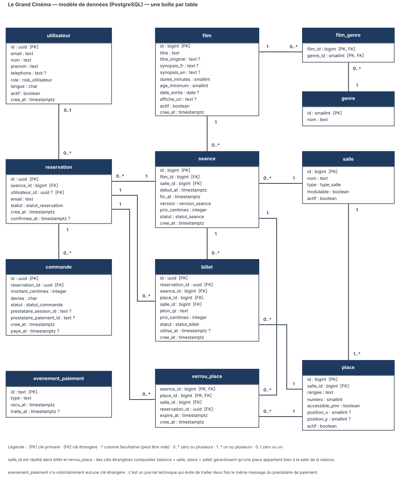
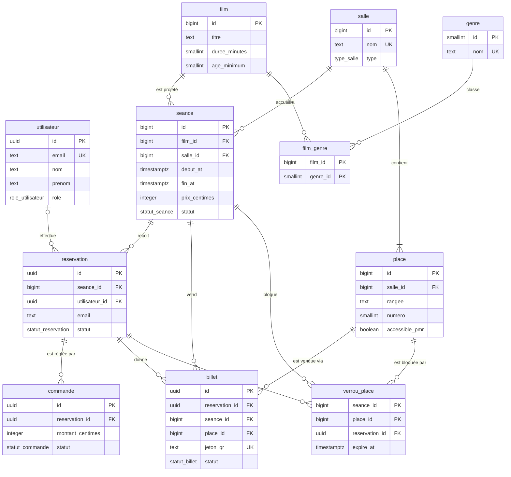

# Modèle de données — Le Grand Cinéma

Ce document décrit la base de données de l'application de réservation : ce qu'elle contient, les règles qu'elle garantit elle-même, et comment la faire évoluer avec les bons outils.

- Script de création : [`db/migrations/0001_modele_initial.sql`](../db/migrations/0001_modele_initial.sql)
- Schéma modifiable : [`docs/schema_base_de_donnees.drawio`](schema_base_de_donnees.drawio) (ouvrir avec [draw.io](https://app.diagrams.net) ou l'extension VS Code « Draw.io Integration »)
- Image du schéma : [`docs/schema_base_de_donnees.png`](schema_base_de_donnees.png)
- Tests et jeu d'essai : [`db/`](../db/README.md)

Le modèle couvre les cinq domaines demandés — **utilisateurs, films, séances, réservations, places** — plus les tables nécessaires pour que le tout fonctionne : salles, genres, billets, verrous de place, commandes (paiement) et journal des événements de paiement.

## 1. Schéma

La version ci-dessous est un diagramme texte (Mermaid) que GitHub affiche directement ; elle ne montre que les colonnes essentielles. La liste complète des colonnes figure dans le dictionnaire (§ 2) et dans le schéma ci-dessus.

## 2. Dictionnaire des tables

| Table | Rôle | Clé primaire | Points d'attention |
|---|---|---|---|
| `utilisateur` | Comptes (spectateurs, professionnels) et personnel (accueil, programmation, administration). | `id` (uuid) | L'adresse e-mail est unique sans tenir compte des majuscules. Les mots de passe ne sont **pas** stockés ici : ils relèvent du service d'authentification, dont l'identifiant sert d'`id`. |
| `film` | Catalogue des films. | `id` | Synopsis en français et en anglais (interface bilingue). `age_minimum` limité à 0, 10, 12, 16 ou 18. |
| `genre` | Référentiel des genres. | `id` | Nom unique. |
| `film_genre` | Lien film ↔ genre (un film peut avoir plusieurs genres). | (`film_id`, `genre_id`) | Supprimer un film supprime ses liens ; un genre encore utilisé ne peut pas être supprimé. |
| `salle` | Salles du cinéma (premium/IMAX, standard, VIP, événementielle). | `id` | `modulable` indique une salle réservable en groupe ou pour un événement. |
| `place` | Un siège d'une salle, identifié par rangée + numéro. | `id` | Unique par (salle, rangée, numéro). `accessible_pmr`, `position_x` et `position_y` servent au plan de salle. |
| `seance` | Projection d'un film dans une salle à une date et une heure. | `id` | Prix en centimes. Statut : brouillon, publiée, annulée. Deux séances non annulées ne peuvent pas se chevaucher dans la même salle. |
| `reservation` | Ensemble de places demandées pour une séance. | `id` (uuid) | `utilisateur_id` est vide pour une réservation sans compte (« invité ») ; l'e-mail permet alors de retrouver les billets. |
| `commande` | Tentative de paiement associée à une réservation. | `id` (uuid) | Montant en centimes. Plusieurs tentatives possibles, une seule peut être « payée ». |
| `evenement_paiement` | Journal des messages reçus du prestataire de paiement. | `id` (texte fourni par le prestataire) | Sert à ne traiter chaque message qu'une fois (idempotence). Aucune clé étrangère, volontairement. |
| `verrou_place` | Blocage temporaire (10 minutes) d'une place pendant le paiement. | (`seance_id`, `place_id`) | Une place ne peut être bloquée que par une seule réservation à la fois. |
| `billet` | Une place vendue = un billet, avec un jeton pour le QR code. | `id` (uuid) | Un seul billet valide ou utilisé par place et par séance. |

Deux vues facilitent la lecture : `vue_places_seance` donne l'état de chaque place d'une séance (libre, verrouillée, vendue) pour afficher le plan de salle ; `vue_remplissage_seance` donne le taux de remplissage de chaque séance.

### Valeurs possibles des statuts

| Champ | Valeurs |
|---|---|
| `utilisateur.role` | spectateur, professionnel, accueil, programmateur, administrateur |
| `salle.type` | premium_imax, standard, vip, evenementielle |
| `seance.version` | vf, vostfr, vo |
| `seance.statut` | brouillon, publiee, annulee |
| `reservation.statut` | en_attente_paiement, confirmee, annulee, expiree |
| `commande.statut` | en_attente, payee, echouee, abandonnee |
| `billet.statut` | valide, utilise, annule |

Les cinq rôles recouvrent les profils du backlog : spectateur = U1 et U2 (U2 pouvant réserver sans compte), professionnel = U3, accueil = U4, programmateur = U5, administrateur = U6.

## 3. Règles de gestion et mécanisme qui les garantit

Chaque règle importante est appliquée par la base elle-même, pas seulement par l'application : un bogue ou un accès direct ne peut donc pas la contourner.

| Règle | Mécanisme dans la base |
|---|---|
| Une place ne peut pas être vendue deux fois pour la même séance. | Index unique partiel `billet_place_vendue_une_fois` sur (`seance_id`, `place_id`) pour les billets valides ou utilisés. Une place dont le billet est annulé redevient vendable. |
| Une place n'est bloquée que par une réservation à la fois. | Clé primaire (`seance_id`, `place_id`) de `verrou_place`. |
| Une place déjà vendue ne peut pas être bloquée. | Fonction `poser_verrou()` et déclencheur `verrou_place_verifier` (filet de sécurité si l'insertion ne passe pas par la fonction). |
| Un blocage expire au bout de 10 minutes et la place est alors réutilisable. | Colonne `expire_at` ; `poser_verrou()` écrase un verrou expiré ; `liberer_verrous_expires()` (tâche planifiée) supprime les verrous expirés. |
| Une place appartient à la salle de la séance. | Clés étrangères composites : (`seance_id`, `salle_id`) vers `seance` et (`place_id`, `salle_id`) vers `place`. C'est pourquoi `salle_id` est répété dans `billet` et `verrou_place`. |
| Le billet et son verrou appartiennent à la séance de leur réservation. | Clé étrangère composite (`reservation_id`, `seance_id`) vers `reservation`. |
| Une salle ne peut pas projeter deux séances en même temps. | Contrainte d'exclusion `seance_pas_de_chevauchement` (extension `btree_gist`) ; les séances annulées sont ignorées. |
| Une séance finit après son début ; les prix et montants ne sont pas négatifs. | Contraintes `CHECK`. |
| Une réservation « confirmée » a une date de confirmation, une commande « payée » a une date de paiement, un billet « utilisé » a une date d'utilisation. | Contraintes `CHECK` de cohérence. |
| Une réservation ne peut être payée qu'une fois. | Index unique partiel `commande_une_seule_payee`. |
| Un message du prestataire de paiement n'est traité qu'une fois. | Clé primaire de `evenement_paiement` : un doublon est refusé à l'insertion. |
| Une adresse e-mail n'a qu'un compte, sans distinction de majuscules ; son format est vérifié. | Index unique sur `lower(email)` et contrainte `CHECK`. |
| On ne supprime pas par erreur un film, une salle ou une séance utilisés. | Clés étrangères en `ON DELETE RESTRICT`. |

Les 28 tests de [`db/tests/contraintes.sql`](../db/tests/contraintes.sql) vérifient ces règles, et [`db/tests/concurrence.sh`](../db/tests/concurrence.sh) vérifie que, si 20 clients tentent de bloquer la même place au même instant, un seul y parvient.

## 4. Choix de conception

- **Montants en centimes entiers** (`prix_centimes`, `montant_centimes`) : pas d'erreur d'arrondi. 12,50 € s'enregistre `1250`.
- **Identifiants uuid pour les données personnelles ou sensibles** (utilisateurs, réservations, commandes, billets) : ils ne se devinent pas et ne révèlent pas le volume de ventes. **Identifiants numériques pour les référentiels** (films, salles, places, séances), plus compacts et plus lisibles.
- **Horodatages avec fuseau** (`timestamptz`) : stockés en UTC, affichés dans le fuseau du cinéma par l'application.
- **Capacité d'une salle non stockée** : c'est le nombre de ses places actives (`vue_remplissage_seance`), pour éviter deux valeurs qui se contredisent.
- **Réservation sans compte** : `reservation.utilisateur_id` peut être vide ; l'e-mail est alors obligatoire pour envoyer et retrouver les billets.
- **Verrou séparé du billet** : le blocage de 10 minutes est temporaire et ne doit jamais être confondu avec une vente ; il disparaît à la confirmation du paiement et le billet est alors créé.

## 5. Hors périmètre de cette version

À traiter dans des migrations ultérieures si le besoin se confirme :

- tarifs différenciés (réduit, enfant) et codes promotionnels : aujourd'hui un seul prix par séance ;
- réservation d'une salle entière avec devis (profil U3) : la table des devis n'existe pas encore ;
- journal d'audit des modifications de programmation ;
- règles de conservation et d'anonymisation des données personnelles (RGPD) ;
- politiques d'accès par ligne (Row Level Security de Supabase) : à définir avec l'authentification.

## 6. Utiliser et modifier la base avec les bons outils

### Regarder et explorer

| Besoin | Outil | Comment |
|---|---|---|
| Voir le schéma et le retoucher à la main | draw.io | Ouvrir `docs/schema_base_de_donnees.drawio` ; l'enregistrer dans le dépôt après modification. |
| Parcourir la base graphiquement (hors ligne) | DBeaver (gratuit) | Nouvelle connexion PostgreSQL, puis clic droit sur le schéma `public` > *Voir le diagramme* pour un diagramme entité-relation généré. |
| Idem avec l'outil officiel PostgreSQL | pgAdmin | Clic droit sur la base > *ERD Tool*. |
| Base hébergée sur Supabase | Supabase Studio | *Table Editor* pour les données, *SQL Editor* pour exécuter un script, *Database > Schema Visualizer* pour le diagramme. |
| Exécuter un script en ligne de commande | `psql` | `psql "$DATABASE_URL" -f db/migrations/0001_modele_initial.sql` |

### Faire évoluer le modèle sans rien casser

1. Créer une branche selon la convention (par exemple `feature/rsv-12-tarif-reduit`).
2. **Ne jamais modifier** `0001_modele_initial.sql` une fois appliqué sur une base partagée : ajouter un nouveau fichier numéroté, par exemple `db/migrations/0002_tarifs.sql`, qui contient uniquement le changement (`alter table …`, `create table …`).
3. Essayer la migration sur une base locale ou de test, charger le jeu d'essai et lancer les tests.
4. Mettre à jour le schéma (`.drawio` et `.png`) et ce document dans la même Pull Request que la migration.
5. Après revue, appliquer la migration à l'environnement suivant.

Avec Supabase, la CLI facilite ce flux : `supabase migration new nom_du_changement` crée le fichier à remplir, `supabase db push` applique les migrations à la base distante, et `supabase db diff` compare l'état de la base à ses migrations. Si le dépôt adopte cette CLI, les fichiers de `db/migrations/` iront dans le dossier `supabase/migrations/` qu'elle utilise.
